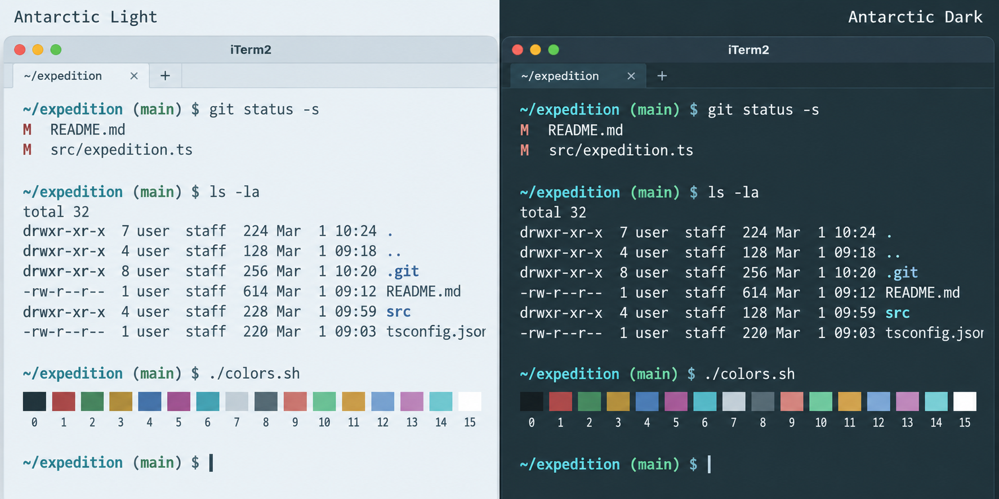

# Antarctic for iTerm2

## Requirements

Install [iTerm2](https://iterm2.com/downloads.html) on macOS. 

These `.itermcolors` files are importable presets.

## Install from GitHub

Download either or both files below. On GitHub, use **Download raw file** to preserve the `.itermcolors` extension.

Import the saved files through **Settings → Profiles → Colors → Color Presets → Import…**, then select the preset:

- [Antarctic Light](https://raw.githubusercontent.com/AntarcticTheme/iTerm2/main/theme/Antarctic-Light.itermcolors)
- [Antarctic Dark](https://raw.githubusercontent.com/AntarcticTheme/iTerm2/main/theme/Antarctic-Dark.itermcolors)

Each preset includes all 16 ANSI colors, background, foreground, bold text, cursor, selection, and links. Use the matching Antarctic prompt or editor theme for a consistent appearance.

## Updates

To update, download the new `.itermcolors` files, import them again, and select the preset.

Released under the MIT license. See [LICENSE](LICENSE).